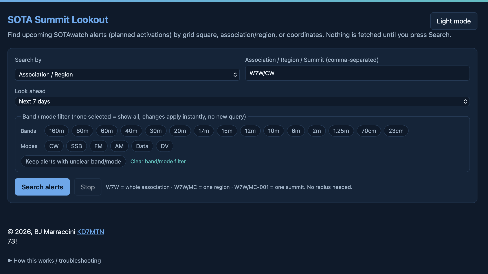
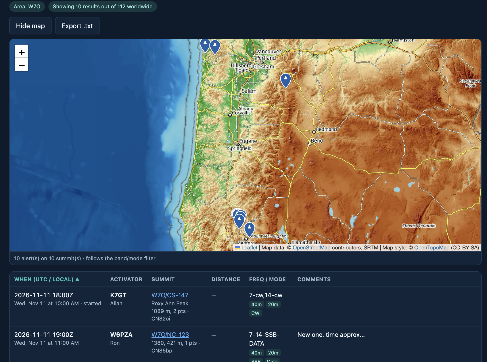

# SOTA Near Me

**Find upcoming SOTA activations near you, built for VHF/UHF and regional HF chasers.**

`SOTA Near Me` is a small, static web app for [Summits on the Air (SOTA)](https://www.sota.org.uk/) chasers. Its primary purpose is to tell VHF/UHF operators when an activator has set an alert near them. It searches [SOTAwatch](https://sotawatch.sota.org.uk/) **alerts** (planned activations) for a grid square, an association or region, or a point on the map, and shows only alerts on bands that work within about 250 miles. Results appear on a topographic map and in a table, can be filtered by band and mode, and can be exported to a text file.

It runs entirely in your browser. There's **no server, no account, no API key, and no tracking**.

**Live site:** https://marracci.github.io/sota-near-me/



---

## Disclaimer

Summit Lookout is an independent project. It is **not affiliated with or endorsed by** Summits on the Air (SOTA), SOTAwatch, SOTLAS or OpenTopoMap. "Summits on the Air" and "SOTA" are names of the SOTA programme.

Alert times, frequencies and locations are whatever activators posted. Always confirm on air.

## Features

- **Three ways to search**
  - **Grid square:** any Maidenhead locator from 4 to 10 characters (e.g. `CN96`, `CN96tm`). Search a radius around the grid's center, or only summits inside the square.
  - **Association / Region / Summit:** `W7W` (whole association), `W7W/MC` (one region), or `W7W/MC-001` (one summit). Separate several with commas.
  - **Latitude / Longitude:** a point and a radius, with an optional "Use my location" button.
- **Look-ahead window:** the next 24 hours, 3 days, 7 days, 30 days, or every posted alert.
- **Regional bands only:** VHF/UHF (6m, 2m, 1.25m, 70cm, 23cm) and regional HF (160m, 80m, 60m, 40m). Alerts posted only for 30m and higher HF bands are left out. See [Which bands are shown](#which-bands-are-shown).
- **Band and mode filters:** narrow to specific bands, or to CW, SSB, FM, AM, Data and DV. Filters apply instantly and don't re-query the API.
- **Map view, shown with every search:** pins on [OpenTopoMap](https://opentopomap.org/) tiles via [Leaflet](https://leafletjs.com/), with the search radius or grid outline drawn on the map. Several alerts on the same summit share one numbered pin. The map opens automatically, and **Hide map** tucks it away.
- **Export:** saves the current, filtered results to a plain `.txt` list.
- **Distance and bearing** from your search point to each summit, in miles or kilometres.
- **Light and dark themes:** dark by default; your choice is remembered between visits.
- **Wildcard alerts** (e.g. `W7W/MC-XXX`) are listed separately rather than dropped.



## How it works

Nothing is fetched until you press **Search alerts**. Then the app:

1. Downloads the current alert list from the SOTA API.
2. In region mode, matches alerts by reference. No coordinates are needed.
3. In grid and lat/lon modes, narrows the list to associations whose bounding box overlaps your search area, looks up coordinates for each alerted summit, and keeps the ones inside your radius or grid.
4. Drops alerts posted only for long-distance HF bands, and says in the status line how many were left out.
5. Shows the matched alerts on the map and in a table. Results can be exported to a `.txt` file.
6. Caches summit coordinates in your browser, so later searches make fewer API calls.

### Which bands are shown

Summit Lookout is for local and regional contacts, so it only lists alerts on bands that reliably work within about 500 miles:

| Group | Bands | Why |
|---|---|---|
| VHF/UHF | 6m, 2m, 1.25m, 70cm, 23cm | Line of sight, extended by summit height |
| Regional HF | 160m, 80m, 60m, 40m | Ground wave and near-vertical skywave (NVIS), roughly 0–250 miles |

- An alert is kept if it lists **at least one** of these bands. `14.285-ssb, 146.52-fm` stays; `14.062-cw` alone does not.
- Alerts with no recognisable band are kept, so nothing is silently missed.
- The status line reports how many alerts in your area were left out.

30m and the higher HF bands usually skip past nearby stations, so they're excluded. 30m is a borderline case that can cover 300–600 miles in daytime. To include it, add `"30m"` to `LOCAL_HF` in `docs/js/sota-alerts.js`.

### Band and mode detection

SOTAwatch alert frequencies are free text, so the app infers band and mode from what the activator typed (`14.062-cw`, `7.2ssb`, `2m fm`, `40-cw 20-cw`, `hf ssb`, and so on). Each result shows the tags it detected. Alerts with no usable frequency are tagged *unclear*, and a toggle controls whether those stay in the list.

Band and mode are matched independently. An alert for `7.032-cw, 146.52-fm` will pass a "2m + CW" filter.

## Using it locally

The app is plain HTML, CSS and JavaScript with no build step.<br>
You can simply clone it locally and open `docs/index.html` to run it. This is simplicity by design.

Serving it over HTTP is more reliable, though, because some browsers restrict `file://` pages:

```bash
git clone https://github.com/<username>/<repo>.git
cd <repo>/docs
python3 -m http.server 8000
# open http://localhost:8000
```


## Security and privacy

- **Content Security Policy:** only the site's own scripts and styles can run. Network access is limited to the SOTA API hosts and OpenTopoMap tiles.
- **Untrusted data is never rendered as HTML.** API text is escaped in tables, and map popups are built from DOM text nodes. This also avoids [CVE-2025-69993](https://nvd.nist.gov/vuln/detail/CVE-2025-69993), a `bindPopup()` XSS issue in Leaflet ≤ 1.9.4.
- **Validated references:** summit references from the API must match the `ASSOC/RG-123` format before they're used in a request URL, and each path segment is encoded.
- **No credentials or cookies** are sent to any API.
- **Location:** "Use my location" runs only when you click it, and it's **rounded to about 1 km** before it's shown or saved.
- **Local storage:** your last search, theme, band/mode filters and a cache of summit coordinates are kept in your browser's `localStorage`. Nothing is sent anywhere else. Clear the coordinate cache from *How this works / troubleshooting* on the page.

Found a security issue? Please open a private security advisory on this repo rather than a public issue.

## Known limitations

- **Not every activation is alerted.** Many activators post spots without an alert, and those won't appear here. For live spots, use [SOTAwatch](https://sotawatch.sota.org.uk/), [SOTLAS](https://sotl.as/) or [HamAlert](https://hamalert.org/).
- **The SOTA API has no published schema specification.** Endpoints or response fields may change without notice. The app tries fallback endpoints and reports errors in the status line.
- **Wildcard alerts** (`-XXX`) can't be placed on the map or measured for distance.
- **Band and mode detection** is heuristic. See [Band and mode detection](#band-and-mode-detection).
- **The 250-mile band rule is mostly because of Line of Sight.**
- **OpenTopoMap** is a free, volunteer-run service. Tiles may load slowly at busy times, and the maximum zoom is 17.

## Data sources and credits

- **Alerts and summit data:** [Summits on the Air](https://www.sota.org.uk/) via the SOTAwatch / SOTA API. All SOTA data belongs to the SOTA programme and is loaded live; this repository contains no SOTA data.
- **Summit coordinates (fallback):** [SOTLAS](https://sotl.as/), which also provides the summit links.
- **Map tiles:** © [OpenTopoMap](https://opentopomap.org/) ([CC-BY-SA](https://creativecommons.org/licenses/by-sa/3.0/)). Map data © [OpenStreetMap](https://www.openstreetmap.org/copyright) contributors, SRTM.
- **Mapping library:** [Leaflet](https://leafletjs.com/) 1.9.4, BSD-2-Clause, © Volodymyr Agafonkin and contributors. Its license is at `docs/vendor/leaflet/LICENSE`.

Please use these free services considerately. The app queries only when you press Search and caches summit coordinates to keep load low.


## License

[MIT](LICENSE) © 2026 B.J. Marraccini

73! KD7MTN
